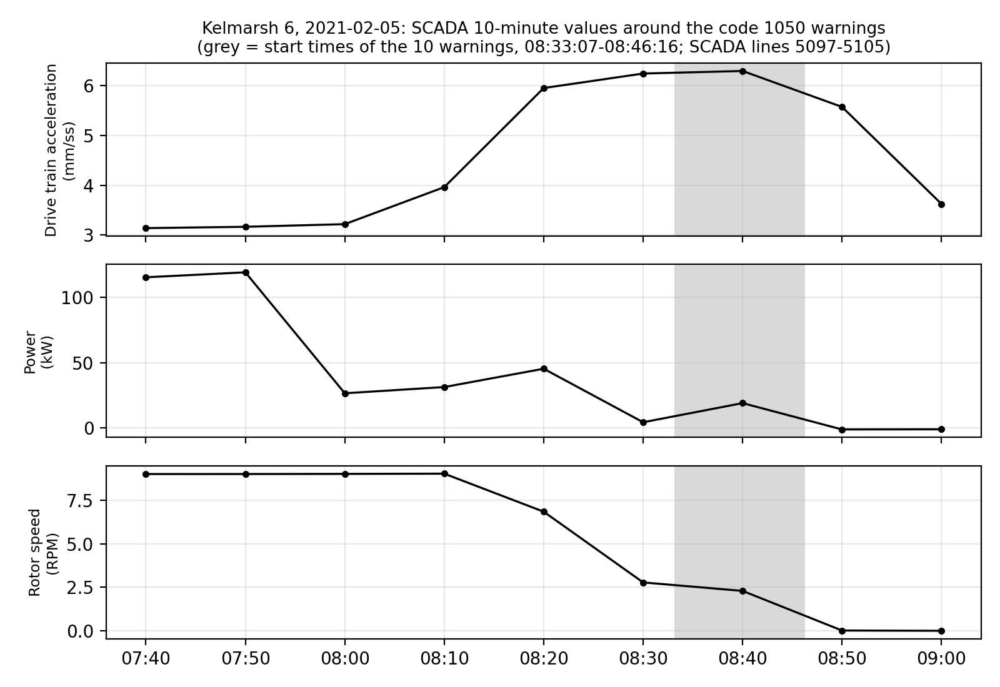

<div class="head"><p>Peter the Great St. Petersburg Polytechnic University</p><p>Course “Knowledge Engineering and Knowledge Management”</p></div>

# Task 1 Report. Initial Knowledge Graph from Structured Records

<p class="sub">Project: Alarm-Centred Knowledge Graph for the Kelmarsh Wind Farm<br>Student: Wu Haoyang</p>

<!-- contents -->

## 1 Data and scope

The aim of Task 1 is to build the first version of the knowledge graph from structured records. The graph links turbine alarms, their codes and the 10-minute SCADA readings, so that a maintenance analyst can ask which measurements were recorded around an alarm and on which part of the turbine they were taken.

The source is the Kelmarsh wind farm data set, version 4 [1]. The scope agreed in the proposal is two turbines (Kelmarsh 1 and Kelmarsh 6), the year 2021, the event statuses Stop and Warning, and 13 of the 303 SCADA columns. The files used are listed in Table 1.

<p class="cap">Table 1 – Source files</p>

| File | Content used |
|---|---|
| `Turbine_Data_Kelmarsh_1_…_228.csv`, `Turbine_Data_Kelmarsh_6_…_233.csv` | 13 of 303 columns, 10-minute rows on alarm days |
| `Status_Kelmarsh_1_…_228.csv`, `Status_Kelmarsh_6_…_233.csv` | Stop and Warning rows |
| `data/manual_signal_component.csv` (own, 13 rows) | Signal → component starter table, one justification per row |

An alarm day is a day on which a Stop or Warning event starts in 2021. There are 109 such days for Kelmarsh 1 and 118 for Kelmarsh 6. All 144 ten-minute rows of these days are loaded.

## 2 Design

### 2.1 Schema

The schema has six node types and five relationship types (Figure 1). A turbine has events, and each event has one event code. A turbine also has observations; each observation belongs to one signal, and a signal measures a quantity of a component.


<p class="cap">Figure 1 – Schema of the Task 1 graph (node counts in brackets)</p>

### 2.2 Stable identifiers

Identifiers are built only from source values (Table 2). Running the build again therefore produces the same identifiers. Every node and every edge also stores `source_file` and `source_line`.

<p class="cap">Table 2 – Node types and identifiers</p>

| Node type | Identifier built from | Example |
|---|---|---|
| Turbine | turbine name from the file header | `turbine:Kelmarsh_6` |
| Event | turbine + line number in the Status file | `event:Kelmarsh_6:L842` |
| EventCode | manufacturer code | `code:1050` |
| Observation | turbine + timestamp + signal | `obs:Kelmarsh_6:2021-02-05T08:30:00:drive_train_acceleration` |
| Signal | normalised SCADA column name | `signal:drive_train_acceleration` |
| Component | name from the manual table | `component:gearbox` |

### 2.3 Nodes and properties

An item is a node when other items refer to it or share it; otherwise it is a property. EventCode is a node: the 547 events share 58 codes, and in these files each code has exactly one fixed message, which is stored once on the code. Signal and Component are nodes because they are shared: each signal has thousands of observations, and the gearbox has four signals (gearbox speed, gear oil temperature, gear oil inlet temperature and gear oil inlet pressure). Observation is a node because each value has its own time and its own source row, and the questions start from a time or a component, not only from a turbine. Time, value, unit, status and duration are properties, because no other entity points to them.

### 2.4 Signal–component links and ambiguous names

MEASURES_ON means that the signal measures a quantity of that subsystem; it does not state where a sensor is mounted. The links come from the manual starter table and carry `evidence=manual`. Two signals, wind speed and power, have no component. Similar names are kept as separate entities: the generator bearing has two temperature signals, the rotor bearing has one, and the gear bearing named in alarm code 1700 is not measured by any selected signal.

## 3 Build

### 3.1 Procedure

The script `build.py` reads the raw CSV files with pandas [3] and builds a NetworkX `MultiDiGraph` [2] in about 20 seconds. Turbine, Signal, Component, Event and EventCode nodes are inserted through functions that check, at insert time, the identifier prefix and the type of both ends of every edge. The 413,879 observations are written directly for speed; their identifiers and types are fixed by construction, and they are checked together with all other nodes and edges by `checks.py` (Section 4). Turbine properties keep the header line of each property in `property_source_lines` (name: line 3, model: line 4, time zone: line 5).

### 3.2 Handling of data problems

Table 3 lists how each problem named in the task is handled and how often it occurred in this build.

<p class="cap">Table 3 – Data problems and their handling</p>

| Problem | Handling | Count (this build) |
|---|---|---|
| Missing values (`NaN` in SCADA) | no Observation created; logged with file and line | 11,065 slots |
| Duplicate Stop/Warning rows / duplicate SCADA timestamps | first kept, rest logged | 0 / 0 |
| Repeated import of the same record | deterministic id, ignored | 493 identical re-inserts |
| Conflicting values for an existing id (e.g. one code, two messages) | first kept, conflict logged | 0 |
| Records outside the schema | Informational and Communication status rows are not imported and are counted | 23,451 + 32 rows |
| Edges with missing endpoints or wrong types | rejected and logged | 0 |
| Event starting before 2021 | kept, `starts_in_scope = False` | 1 per turbine |

Of the 493 identical re-inserts, 489 are EventCode nodes (547 events share 58 codes, and 547 − 58 = 489). The other 4 are Component nodes shared by several signals (13 − 2 − 7 = 4).

## 4 Check

### 4.1 Graph statistics

The script `checks.py` writes `output/checks/check_report.md`. The graph size is given in Table 4 and the events per turbine in Table 5.

<p class="cap">Table 4 – Graph statistics</p>

| Item | Count |
|---|---|
| Nodes | 414,506 |
| Edges | 828,863 |
| Observation / HAS_OBSERVATION / OF_SIGNAL | 413,879 each |
| Event / HAS_EVENT / HAS_CODE | 547 each |
| EventCode | 58 |
| Signal / Component / MEASURES_ON | 13 / 7 / 11 |

<p class="cap">Table 5 – Events by turbine</p>

| Turbine | Stop | Warning |
|---|---|---|
| Kelmarsh 1 | 132 | 179 |
| Kelmarsh 6 | 117 | 119 |

### 4.2 Integrity checks

The results of the integrity checks are given in Table 6.

<p class="cap">Table 6 – Integrity checks</p>

| Check | Result |
|---|---|
| Identifier prefix matches node type; required properties present; provenance present | 0 problems |
| Every edge connects existing nodes of the allowed types | 0 problems |
| Every Observation has one turbine and one signal; every Event has one turbine and one code | 0 violations |
| Rebuild from raw files gives the same nodes, edges and all their properties | yes (0 differences) |
| Importing the Status files a second time changes the graph | no (414,506 / 828,863 before and after) |

### 4.3 Facts checked against the sources

A sample of 50 facts was drawn with seed 42, stratified as 25 observations, 10 events, 10 event codes and 5 component links. For each fact the cited source line was opened again and the cited field was compared with the graph. The automatic comparison found that 50 of 50 facts match. For the manual comparison, the author opens each cited line and records the result in the `human_verdict` column of `output/checks/fact_verification_sample.csv`. The current count of filled and correct verdicts is printed in `output/checks/check_report.md`. Re-running the checks keeps these verdicts.

## 5 Query

The script `queries.py` runs the planned questions and saves the answers to `output/results/`.

### 5.1 Q1. Which gearbox measurements are available for Kelmarsh 6 on an alarm day (2021-02-05)?

The query follows three domain relationships: Turbine → Observation → Signal → Component. It returns four gearbox signals × 144 ten-minute values = 576 values, none missing. Each value cites its SCADA line (5051–5194).

### 5.2 Q2. When did the turbines report alarm code 1050?

The path is Turbine → Event → EventCode. Kelmarsh 6 has 10 Warning events “Drivetrain oscillations”, starting between 08:33:07 and 08:46:16 on 2021-02-05 (Status lines 842–873). Kelmarsh 1 has none. The same query for code 1700 (“High temp. gear bearing 1”) returns 3 Warning events on Kelmarsh 6 (lines 593, 1661 and 13351).

### 5.3 Q3. What did the sensors record near the Kelmarsh 6 alarm at 2021-02-05 08:33:07?

The query combines Turbine → Event (alarm time) with Turbine → Observation → Signal over a window from 60 minutes before to 30 minutes after the alarm. It returns 9 timestamps × 13 signals (SCADA lines 5097–5105). Drive train acceleration rises from 3.22 mm/ss at 08:00 (line 5099) to 6.24 at 08:30 (line 5102). Rotor speed falls from 9.0 RPM at 08:10 (line 5100) to 0.01 RPM at 08:50 (line 5104) (Figure 2).



<p class="cap">Figure 2 – Drive train acceleration and rotor speed around the alarm (Q3)</p>

### 5.4 Limitations

The link between an alarm and a sensor change is a time association; the data contain no repair records and no confirmed root causes. SCADA timestamps are the exported 10-minute stamps (UTC), so an alarm at 08:33 is compared with the rows stamped 08:30 and 08:40. Only alarm days that start in 2021 are loaded; for any other day, Q1 and Q3 answer “not loaded” instead of reporting missing values, including the day of the one event per turbine that started in 2020. Signal → component links cover only the 13 selected signals and were made by hand. Signal identifiers come from SCADA column names; the data set's signal-mapping file and static turbine file (manufacturer signal names, turbine aliases such as KWF6) are not yet included. Both turbines are the same model (Senvion MM92) with the same owner, so questions comparing manufacturers, models or companies cannot be answered from these data.

## 6 Reproducibility and use of LLMs

The graph is rebuilt with the following commands:

```bash
pip install -r requirements.txt
set KELMARSH_DATA_DIR=<folder with the unzipped Kelmarsh_SCADA_2021_4456.zip>
python build.py && python checks.py && python queries.py && python make_figures.py
```

The PDF of this report is produced by `python make_pdf.py`. It needs Microsoft Edge or Google Chrome.

The code was written with Claude Code (model Claude Opus 5.5) on 2026-11-15 and 2026-11-16. It was then reviewed by ChatGPT/Codex on 2026-11-16 and by the author. Tools, roles, example prompts and settings are listed in `README.md`, Section 7. No model output is stored as a graph fact: every node and edge comes from a cited CSV line or from the manual table, and the build makes no model calls.

## 7 Conclusion

1. A knowledge graph of 414,506 nodes and 828,863 edges was built from the Kelmarsh 1 and Kelmarsh 6 records of 2021 with deterministic identifiers and source references for every node and edge.
2. Missing values, duplicates, repeated imports and out-of-schema records are handled and logged; the integrity checks report 0 problems, and a rebuild gives an identical graph.
3. Fifty sampled facts match their source lines in the automatic comparison; the manual verdicts are recorded in `fact_verification_sample.csv`.
4. Three planned questions are answered by runnable queries with saved results; Q1 follows three domain relationships.

## References

1. Plumley C., Takeuchi R. Kelmarsh wind farm data. Version 4. Zenodo, 2025. DOI: 10.5281/zenodo.16807551. Licence CC BY 4.0.
2. Hagberg A. A., Schult D. A., Swart P. J. Exploring network structure, dynamics, and function using NetworkX // Proceedings of the 7th Python in Science Conference (SciPy 2008). 2008. P. 11–15.
3. McKinney W. Data structures for statistical computing in Python // Proceedings of the 9th Python in Science Conference (SciPy 2010). 2010. P. 56–61.
