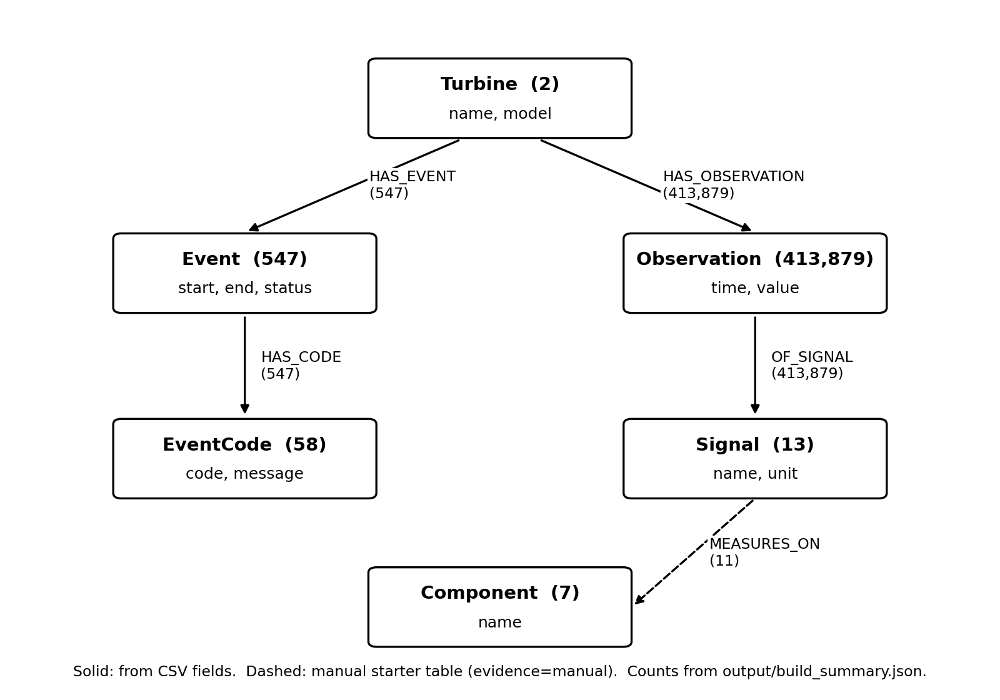
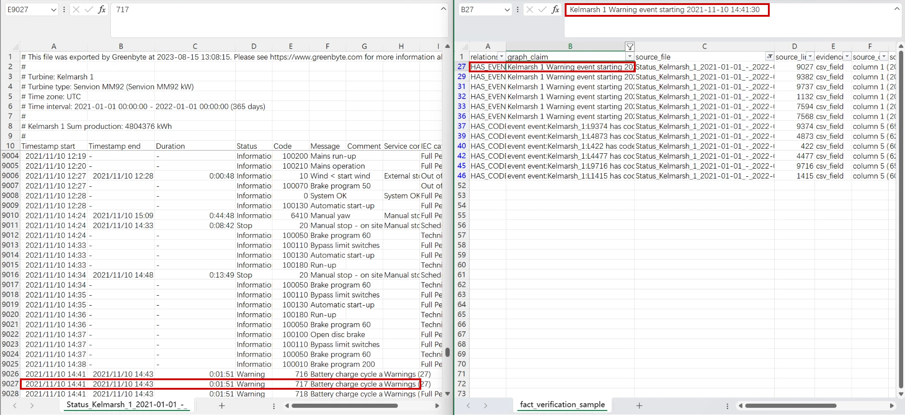
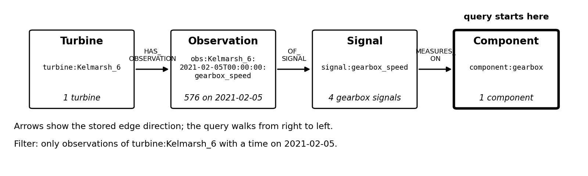
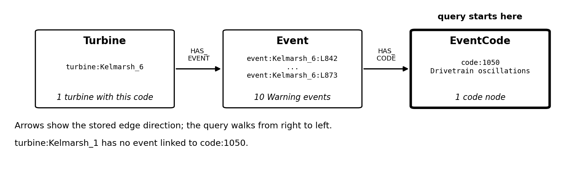
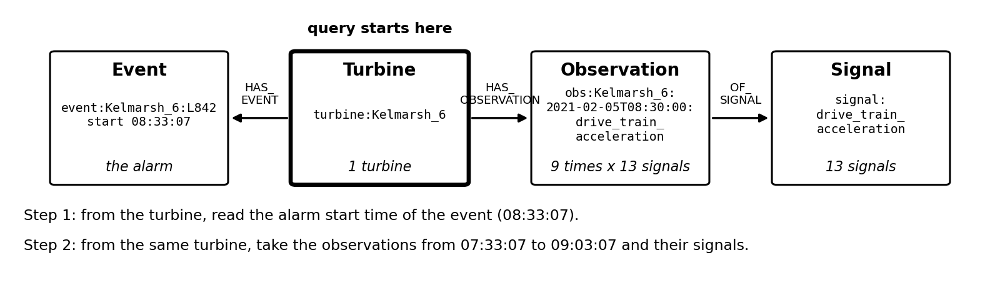

Peter the Great St. Petersburg Polytechnic University

Course “Knowledge Engineering and Knowledge Management”

# Task 1 Report. Initial Knowledge Graph from Structured Records

Project: Alarm-Centred Knowledge Graph for the Kelmarsh Wind Farm Student: Wu Haoyang

<!-- contents -->

## 1 Background and aim

### 1.1 Problem

A wind turbine describes its own state in two kinds of records. Alarm records (the Status file) state when the turbine stopped or warned about a problem and give a manufacturer code, for example code 1050 “Drivetrain oscillations”. SCADA records (Supervisory Control and Data Acquisition) store sensor readings, such as rotor speed or gear oil temperature, every ten minutes. When an alarm appears, a maintenance engineer wants to know what the sensors showed before and after it and which part of the turbine those sensors belong to. In the raw files this means matching times across two large tables and knowing which column belongs to which part; the files themselves do not record these links.

### 1.2 Task 1 in the project

The project has two tasks. Task 1, reported here, builds the graph from the structured records (alarm and SCADA tables) and checks it. Task 2 will add knowledge extracted from text and link it to this graph. The report follows the four steps required for Task 1: design (Section 3), build (Section 4), check (Section 5) and query (Section 6). The main terms are explained in Table 1.

Table 1 – Terms used in this report

| Term | Meaning |
|---|---|
| SCADA record | 10-minute sensor values of one turbine (file `Turbine_Data`) |
| Alarm event | one Stop or Warning row in the Status file |
| Alarm code | manufacturer number of an alarm with a fixed message, e.g. 1050 “Drivetrain oscillations” |
| Signal | one measured quantity, i.e. one SCADA column such as Rotor speed (RPM) |
| Component | part of the turbine that a signal describes, e.g. the gearbox |
| Observation | one value of one signal at one time |
| Node, edge | an item in the graph; a link between two items |
| Provenance | source file and line number stored with every node and edge |

## 2 Data and scope

The data are the Kelmarsh wind farm data set, version 4 [1], which contains alarm (Status) and SCADA files for each turbine of the farm. Task 1 uses a part of it, chosen as follows:

- **Turbines Kelmarsh 1 and Kelmarsh 6.** Kelmarsh 6 has the alarms used in the questions (code 1050 “Drivetrain oscillations” and code 1700 “High temp. gear bearing 1”). Kelmarsh 1 has no code-1050 alarm, so the two turbines can be compared.
- **Year 2021.** The downloaded data package covers 2021.
- **Stop and Warning rows only.** These rows report stops and faults. The other 23,451 Status rows are Informational, mainly routine messages such as “System OK” or “Run-up”, and 32 rows are Communication messages.
- **13 of the 303 SCADA columns.** Wind speed and power describe the operating condition. The other 11 columns cover the main mechanical parts from the rotor to the generator and the tower, including the drivetrain named in code 1050.
- **Only alarm days.** All questions start from an alarm. Loading every day would give up to 1,366,560 observations (2 turbines × 52,560 rows × 13 columns); the alarm days give 413,879 observations and still answer every planned question.

The files used are listed in Table 2.

Table 2 – Source files

| File | Content used |
|---|---|
| `Turbine_Data_Kelmarsh_1_…_228.csv`, `Turbine_Data_Kelmarsh_6_…_233.csv` | 13 of 303 columns, 10-minute rows on alarm days |
| `Status_Kelmarsh_1_…_228.csv`, `Status_Kelmarsh_6_…_233.csv` | Stop and Warning rows |
| `data/manual_signal_component.csv` (own, 13 rows) | Signal → component starter table, one justification per row |

An alarm day is a day on which a Stop or Warning event starts in 2021. There are 109 such days for Kelmarsh 1 and 118 for Kelmarsh 6. All 144 ten-minute rows of these days are loaded.

## 3 Design

This section defines what is stored in the graph, how each item is identified and why some items are nodes and others are properties.

### 3.1 Schema

The schema has six node types and five relationship types (Figure 1). A turbine has events, and each event has one event code. A turbine also has observations; each observation belongs to one signal, and a signal measures a quantity of a component.

Figure 1 – Schema of the Task 1 graph (node counts in brackets)

### 3.2 Stable identifiers

Identifiers are built only from source values (Table 3). Running the build again therefore produces the same identifiers. Every node and every edge also stores `source_file` and `source_line`.

Table 3 – Node types and identifiers

| Node type | Identifier built from | Example |
|---|---|---|
| Turbine | turbine name from the file header | `turbine:Kelmarsh_6` |
| Event | turbine + line number in the Status file | `event:Kelmarsh_6:L842` |
| EventCode | manufacturer code | `code:1050` |
| Observation | turbine + timestamp + signal | `obs:Kelmarsh_6:2021-02-05T08:30:00:drive_train_acceleration` |
| Signal | normalised SCADA column name | `signal:drive_train_acceleration` |
| Component | name from the manual table | `component:gearbox` |

### 3.3 Nodes and properties

An item is a node when other items refer to it or share it; otherwise it is a property. EventCode is a node: the 547 events share 58 codes, and in these files each code has exactly one fixed message, which is stored once on the code. Signal and Component are nodes because they are shared: each signal has thousands of observations, and the gearbox has four signals (gearbox speed, gear oil temperature, gear oil inlet temperature and gear oil inlet pressure). Observation is a node because each value has its own time and its own source row, and the questions start from a time or a component, not only from a turbine. Time, value, unit, status and duration are properties, because no other entity points to them.

### 3.4 Signal–component links and ambiguous names

MEASURES_ON means that the signal measures a quantity of that subsystem; it does not state where a sensor is mounted. The links come from the manual starter table and carry `evidence=manual`. Two signals, wind speed and power, have no component. Similar names are kept as separate entities: the generator bearing has two temperature signals, the rotor bearing has one, and the gear bearing named in alarm code 1700 is not measured by any selected signal.

## 4 Build

This section describes how the raw files are turned into the graph and how missing, repeated or unusual records are treated.

### 4.1 Procedure

The script `build.py` reads the raw CSV files with pandas [3] and builds a NetworkX `MultiDiGraph` [2] in about 20 seconds. Turbine, Signal, Component, Event and EventCode nodes are inserted through functions that check, at insert time, the identifier prefix and the type of both ends of every edge. The 413,879 observations are written directly for speed; their identifiers and types are fixed by construction, and they are checked together with all other nodes and edges by `checks.py` (Section 5). Turbine properties keep the header line of each property in `property_source_lines` (name: line 3, model: line 4, time zone: line 5).

### 4.2 Handling of data problems

Table 4 lists how each problem named in the task is handled and how often it occurred in this build.

Table 4 – Data problems and their handling

| Problem | Handling | Count (this build) |
|---|---|---|
| Missing values (`NaN` in SCADA) | no Observation created; logged with file and line | 11,065 slots |
| Duplicate Stop/Warning rows / duplicate SCADA timestamps | first kept, rest logged | 0 / 0 |
| Repeated import of the same record | deterministic id, ignored | 493 identical re-inserts |
| Conflicting values for an existing id (e.g. one code, two messages) | first kept, conflict logged | 0 |
| Records outside the schema | Informational and Communication status rows are not imported and are counted | 23,451 + 32 rows |
| Edges with missing endpoints or wrong types | rejected and logged | 0 |
| Event starting before 2021 | kept, `starts_in_scope = False` | 1 per turbine |

Of the 493 identical re-inserts, 489 are EventCode nodes (547 events share 58 codes, and 547 − 58 = 489). The other 4 are Component nodes shared by several signals (13 − 2 − 7 = 4).

## 5 Check

This section shows that the graph is consistent and that its facts agree with the source files, first by program and then by hand.

### 5.1 Graph statistics

The script `checks.py` writes `output/checks/check_report.md`. The graph size is given in Table 5 and the events per turbine in Table 6.

Table 5 – Graph statistics

| Item | Count |
|---|---|
| Nodes | 414,506 |
| Edges | 828,863 |
| Observation / HAS_OBSERVATION / OF_SIGNAL | 413,879 each |
| Event / HAS_EVENT / HAS_CODE | 547 each |
| EventCode | 58 |
| Signal / Component / MEASURES_ON | 13 / 7 / 11 |

Table 6 – Events by turbine

| Turbine | Stop | Warning |
|---|---|---|
| Kelmarsh 1 | 132 | 179 |
| Kelmarsh 6 | 117 | 119 |

### 5.2 Integrity checks

The results of the integrity checks are given in Table 7.

Table 7 – Integrity checks

| Check | Result |
|---|---|
| Identifier prefix matches node type; required properties present; provenance present | 0 problems |
| Every edge connects existing nodes of the allowed types | 0 problems |
| Every Observation has one turbine and one signal; every Event has one turbine and one code | 0 violations |
| Rebuild from raw files gives the same nodes, edges and all their properties | yes (0 differences) |
| Importing the Status files a second time changes the graph | no (414,506 / 828,863 before and after) |

### 5.3 Facts checked against the sources

A sample of 50 facts was drawn with seed 42, stratified as 25 observations, 10 events, 10 event codes and 5 component links. For each fact the cited source line was opened again and the cited field was compared with the graph. The automatic comparison found that 50 of 50 facts match.

The manual check was done by the author in Microsoft Excel with two tables side by side (Figure 2). The left window is the original source file from the data set, opened without changes; in Figure 2 it is `Status_Kelmarsh_1_…_228.csv`. The right window is the verification sheet `output/checks/fact_verification_sample.csv`, which lists for each sampled fact the graph claim, the cited source file and line, and two columns for the author's result, `human_verdict` and `human_note`. For each fact the author typed the cited cell into the Name Box (for example `A9027`), compared the time, status, code, message, column name or value with the graph claim, and entered `correct` or `wrong`. All 50 facts were marked correct. The count is printed in `output/checks/check_report.md`, and re-running the checks keeps the verdicts.

In the Status and SCADA files, lines 1–9 are comments starting with “#” (exporter, turbine, turbine type, time zone and time interval), line 10 is the header, and every later line is one record; the Excel row number therefore equals the file line number. The manual table has its header on line 1. The columns of the original files are explained in Table 8, and the columns of the verification sheet in Table 9.

Table 8 – Columns of the original files

| File | Column | Meaning |
|---|---|---|
| Status file | Timestamp start | time the event started (UTC) |
| Status file | Timestamp end | time the event ended |
| Status file | Duration | length of the event |
| Status file | Status | event type: Stop, Warning, Informational or Communication |
| Status file | Code | manufacturer alarm code |
| Status file | Message | text of the alarm code |
| Status file | Comment, Service contract category, IEC category, Global contract category, Custom contract category | operator comment and availability categories; not used in Task 1 |
| SCADA file (`Turbine_Data`) | Date and time | timestamp of the 10-minute row (UTC) |
| SCADA file (`Turbine_Data`) | 302 signal columns, e.g. Rotor speed (RPM), Gear oil temperature (°C) | 10-minute values, unit in brackets; 13 of these columns are used (Section 2) |
| Manual table | scada_column, signal_id, component_id, component_name, justification | SCADA column name, signal identifier in the graph, component identifier, component name, reason for the link |

Table 9 – Columns of the verification sheet

| Column | Meaning |
|---|---|
| relationship | type of the sampled edge: HAS_OBSERVATION, HAS_EVENT, HAS_CODE or MEASURES_ON |
| graph_claim | the fact as stated by the graph |
| source_file | file from which the fact was built |
| source_line | line in that file (equal to the Excel row number) |
| evidence | `csv_field` (read from a CSV field) or `manual` (manual table) |
| source_columns | columns of the source line that hold the fact |
| source_values | values in those columns, read again by `checks.py` |
| raw_line_excerpt | first 160 characters of the source line |
| auto_match | TRUE if the automatic comparison found the same values |
| human_verdict | verdict of the author: `correct` or `wrong` |
| human_note | remark of the author (empty when there is nothing to note) |

Figure 2 – Manual check of one fact. Left: original Status file of Kelmarsh 1, line 9027 (start time and status Warning). Right: verification sheet, row 27, with the graph claim in the formula bar

## 6 Query

This section uses the graph to answer three of the planned questions and states what the answers can and cannot show.

Each question is run with one command of `queries.py`. The answer is saved as a CSV file in `output/results/`, and every row of the answer cites the source file and line it comes from. Table 10 gives an overview; the subsections explain for each question why it is asked, how the graph answers it, what the answer is and what it shows.

Table 10 – Planned questions answered in Task 1

| Question | Path in the graph (relationships) | Command | Saved result |
|---|---|---|---|
| Q1. Gearbox measurements of Kelmarsh 6 on 2021-02-05 | Component ← Signal ← Observation ← Turbine (3) | `python queries.py q1` | `q1_gearbox_kelmarsh6_2021-02-05.csv` |
| Q2. Events with alarm code 1050 | EventCode ← Event ← Turbine (2) | `python queries.py q2` | `q2_code1050.csv` |
| Q3. Sensor values around the Kelmarsh 6 alarm at 08:33:07 | Turbine → Event; Turbine → Observation → Signal (3) | `python queries.py q3` | `q3_kelmarsh6_2021-02-05_0833.csv` |

### 6.1 Q1. Which gearbox measurements are available for Kelmarsh 6 on an alarm day (2021-02-05)?

**Why this question.** When an alarm points to the drivetrain, an engineer first needs to know which gearbox data exist for that day. The day 2021-02-05 is chosen because Kelmarsh 6 reported the code-1050 alarms on it (Q2).

**How the graph answers it.** The query starts at the node `component:gearbox`, follows MEASURES_ON back to the four gearbox signals, follows OF_SIGNAL back to their observations, and keeps the observations that belong to `turbine:Kelmarsh_6` (HAS_OBSERVATION) and have a time on 2021-02-05. The SCADA file alone cannot answer this question, because it does not say which columns belong to the gearbox; this link comes from the MEASURES_ON edges (Figure 3).

Figure 3 – Path of Q1 in the graph, with real node identifiers (thick box: start of the query)

**Answer.** Four signals × 144 ten-minute values = 576 values, none missing, from SCADA lines 5051–5194 (Table 11).

Table 11 – Q1 result: gearbox signals of Kelmarsh 6 on 2021-02-05

| Signal | Unit | Values | Minimum | Maximum | SCADA lines |
|---|---|---|---|---|---|
| Gearbox speed | RPM | 144 | 0.36 | 1132.58 | 5051–5194 |
| Gear oil temperature | °C | 144 | 24.40 | 57.51 | 5051–5194 |
| Gear oil inlet temperature | °C | 144 | 18.95 | 56.14 | 5051–5194 |
| Gear oil inlet pressure | bar | 144 | 0.20 | 95.49 | 5051–5194 |

**What it shows.** All four gearbox signals are complete for the day. The minimum gearbox speed of 0.36 RPM shows that the gearbox almost stood still during part of the day.

### 6.2 Q2. When did the turbines report alarm code 1050?

**Why this question.** An engineer usually starts from an alarm code and wants every occurrence of it on all turbines.

**How the graph answers it.** The query starts at the node `code:1050`, follows HAS_CODE back to all events with this code and HAS_EVENT back to their turbines. Because the code is one node shared by all its events, one step finds every occurrence (Figure 4).

Figure 4 – Path of Q2 in the graph, with real node identifiers (thick box: start of the query)

**Answer.** Kelmarsh 6 has 10 Warning events “Drivetrain oscillations” on 2021-02-05, starting between 08:33:07 and 08:46:16 (Status lines 842–873, Table 12). Kelmarsh 1 has none. The same query for code 1700 (“High temp. gear bearing 1”, `python queries.py q2 --code 1700`) returns 3 Warning events on Kelmarsh 6 (lines 593, 1661 and 13351).

Table 12 – Q2 result: events with code 1050 (all on Kelmarsh 6)

| Event | Start | End | Duration | Status line |
|---|---|---|---|---|
| `event:Kelmarsh_6:L842` | 2021-02-05 08:33:07 | 2021-02-05 08:33:09 | 00:00:02 | 842 |
| `event:Kelmarsh_6:L844` | 2021-02-05 08:33:14 | 2021-02-05 08:33:16 | 00:00:02 | 844 |
| `event:Kelmarsh_6:L846` | 2021-02-05 08:33:16 | 2021-02-05 08:33:18 | 00:00:02 | 846 |
| `event:Kelmarsh_6:L848` | 2021-02-05 08:33:34 | 2021-02-05 08:33:36 | 00:00:02 | 848 |
| `event:Kelmarsh_6:L850` | 2021-02-05 08:33:41 | 2021-02-05 08:33:43 | 00:00:02 | 850 |
| `event:Kelmarsh_6:L852` | 2021-02-05 08:33:44 | 2021-02-05 08:33:46 | 00:00:02 | 852 |
| `event:Kelmarsh_6:L855` | 2021-02-05 08:33:55 | 2021-02-05 08:33:57 | 00:00:02 | 855 |
| `event:Kelmarsh_6:L863` | 2021-02-05 08:40:36 | 2021-02-05 08:40:38 | 00:00:02 | 863 |
| `event:Kelmarsh_6:L872` | 2021-02-05 08:46:14 | 2021-02-05 08:46:16 | 00:00:02 | 872 |
| `event:Kelmarsh_6:L873` | 2021-02-05 08:46:16 | 2021-02-08 13:43:43 | 76:57:27 | 873 |

**What it shows.** The alarm came as nine short warnings of two seconds within 13 minutes, and the tenth warning stayed active for 76 hours 57 minutes, until 2021-02-08 13:43:43. Kelmarsh 1 never reported this code in 2021.

### 6.3 Q3. What did the sensors record near the Kelmarsh 6 alarm at 2021-02-05 08:33:07?

**Why this question.** After finding an alarm (Q2), the engineer wants to see what all sensors of the turbine recorded before and after it.

**How the graph answers it.** The query takes the start time of `event:Kelmarsh_6:L842` (HAS_EVENT from `turbine:Kelmarsh_6`) and sets a window from 60 minutes before to 30 minutes after it (07:33:07–09:03:07). It then follows HAS_OBSERVATION from the same turbine to the observations in this window and OF_SIGNAL to their signals (Figure 5).

Figure 5 – Path of Q3 in the graph, with real node identifiers (thick box: start of the query)

**Answer.** Nine 10-minute timestamps (07:40–09:00) × 13 signals, from SCADA lines 5097–5105. Table 13 shows five of the 13 signals; the full answer is in the saved file.

Table 13 – Q3 result (5 of 13 signals)

| Time | SCADA line | Drive train acceleration (mm/ss) | Rotor speed (RPM) | Gearbox speed (RPM) | Power (kW) | Wind speed (m/s) |
|---|---|---|---|---|---|---|
| 07:40 | 5097 | 3.14 | 9.00 | 1071.45 | 115.35 | 4.09 |
| 07:50 | 5098 | 3.16 | 9.00 | 1071.46 | 119.16 | 4.10 |
| 08:00 | 5099 | 3.22 | 9.01 | 1072.60 | 26.52 | 2.91 |
| 08:10 | 5100 | 3.96 | 9.02 | 1073.42 | 31.27 | 3.04 |
| 08:20 | 5101 | 5.95 | 6.84 | 812.77 | 45.30 | 3.65 |
| 08:30 | 5102 | 6.24 | 2.78 | 333.13 | 4.31 | 3.57 |
| 08:40 | 5103 | 6.29 | 2.29 | 272.41 | 18.96 | 3.88 |
| 08:50 | 5104 | 5.57 | 0.01 | 6.47 | -1.19 | 3.44 |
| 09:00 | 5105 | 3.62 | 0.00 | 4.65 | -1.10 | 3.01 |

**What it shows.** Around the alarm, drive train acceleration roughly doubled, from 3.22 mm/ss at 08:00 (line 5099) to 6.24 at 08:30 (line 5102). At the same time the rotor slowed from about 9 RPM to 0.01 RPM at 08:50 (line 5104) and power fell to slightly below zero, while wind speed stayed between 2.91 and 4.10 m/s (Figure 6). These values occur at the same time as the alarm; they do not prove what caused it.

Figure 6 – Drive train acceleration and rotor speed around the alarm (Q3)

### 6.4 Limitations

The link between an alarm and a sensor change is a time association; the data contain no repair records and no confirmed root causes. SCADA timestamps are the exported 10-minute stamps (UTC), so an alarm at 08:33 is compared with the rows stamped 08:30 and 08:40. Only alarm days that start in 2021 are loaded; for any other day, Q1 and Q3 answer “not loaded” instead of reporting missing values, including the day of the one event per turbine that started in 2020. Signal → component links cover only the 13 selected signals and were made by hand. Signal identifiers come from SCADA column names; the data set's signal-mapping file and static turbine file (manufacturer signal names, turbine aliases such as KWF6) are not yet included. Both turbines are the same model (Senvion MM92) with the same owner, so questions comparing manufacturers, models or companies cannot be answered from these data.

## 7 Conclusion

1. A knowledge graph of 414,506 nodes and 828,863 edges was built from the Kelmarsh 1 and Kelmarsh 6 records of 2021 with deterministic identifiers and source references for every node and edge.
2. Missing values, duplicates, repeated imports and out-of-schema records are handled and logged; the integrity checks report 0 problems, and a rebuild gives an identical graph.
3. Fifty sampled facts match their source lines in the automatic comparison and in the manual check by the author in the original files (50 of 50 correct).
4. Three planned questions are answered by runnable queries with saved results; Q1 follows three domain relationships.

## References

1. Plumley C., Takeuchi R. Kelmarsh wind farm data. Version 4. Zenodo, 2025. DOI: 10.5281/zenodo.16807551. Licence CC BY 4.0.
2. Hagberg A. A., Schult D. A., Swart P. J. Exploring network structure, dynamics, and function using NetworkX // Proceedings of the 7th Python in Science Conference (SciPy 2008). 2008. P. 11–15.
3. McKinney W. Data structures for statistical computing in Python // Proceedings of the 9th Python in Science Conference (SciPy 2010). 2010. P. 56–61.
