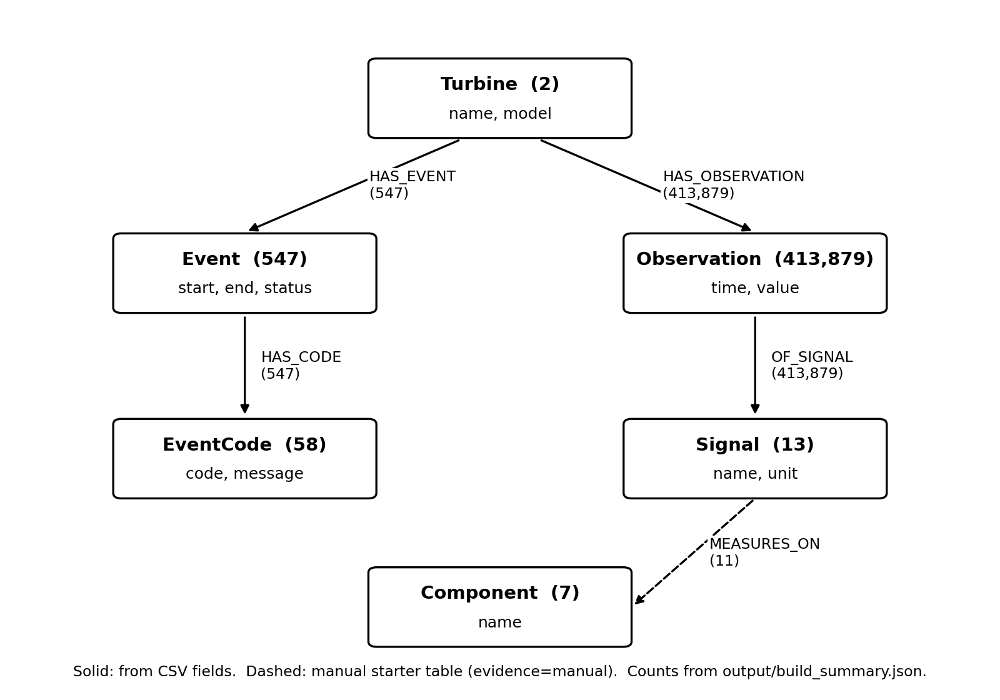
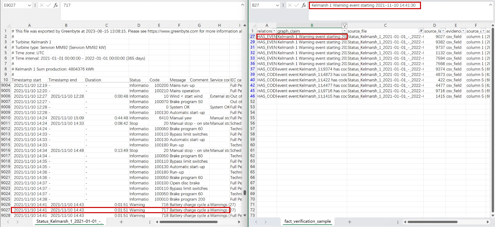
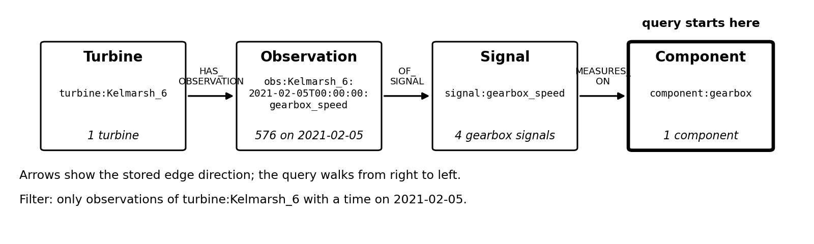
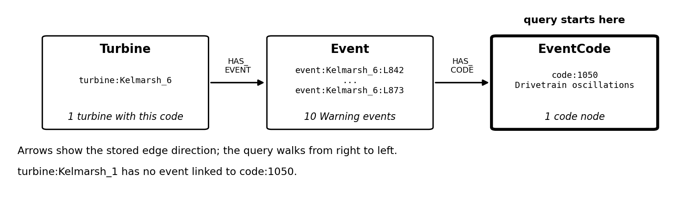
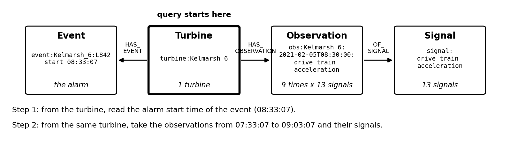
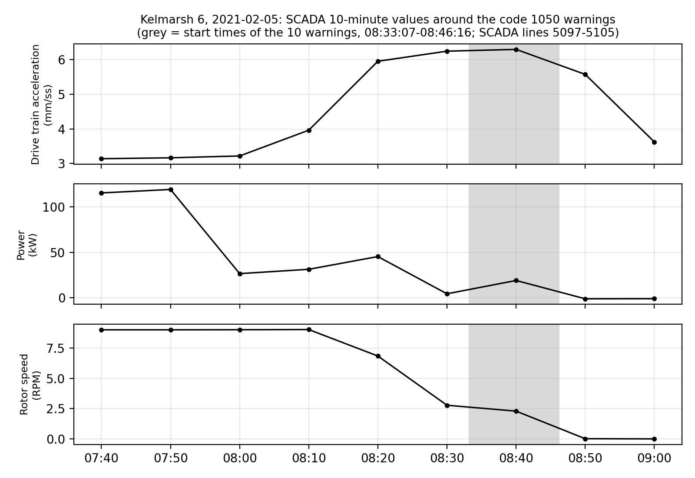

彼得大帝圣彼得堡理工大学

课程《知识工程与知识管理》

# 任务 1 报告：基于结构化记录的初始知识图谱

项目：以报警为中心的 Kelmarsh 风电场知识图谱 学生：Wu Haoyang

<!-- contents -->

## 1 背景与目标

### 1.1 问题

风机用两类记录描述自身状态。报警记录（Status 文件）说明风机何时停机或发出警告，并给出制造商代码，例如代码 1050 “Drivetrain oscillations”（传动链振荡）。SCADA 记录（数据采集与监视控制系统）每十分钟保存一次传感器读数，例如转子转速或齿轮油温度。出现报警时，维护工程师想知道报警前后传感器显示了什么，以及这些传感器属于风机的哪个部件。在原始文件中，这需要在两张大表之间按时间匹配，还要知道哪一列属于哪个部件；文件本身并不记录这些联系。

### 1.2 任务 1 在项目中的位置

项目分为两个任务。本报告的任务 1 用结构化记录（报警表和 SCADA 表）构建图谱并进行检查。任务 2 将从文本中抽取知识，并把它连接到这个图谱上。本报告按任务 1 要求的四个步骤展开：设计（第 3 节）、构建（第 4 节）、检查（第 5 节）和查询（第 6 节）。主要术语见表 1。

表 1 – 本报告使用的术语

| 术语 | 含义 |
|---|---|
| SCADA 记录 | 一台风机每 10 分钟的传感器数值（`Turbine_Data` 文件） |
| 报警事件 | Status 文件中的一行 Stop 或 Warning 记录 |
| 报警代码 | 制造商给报警编的号码，带固定描述，例如 1050 “Drivetrain oscillations” |
| 信号 | 一个被测量的量，即一个 SCADA 列，例如 Rotor speed (RPM) |
| 部件 | 信号所描述的风机部分，例如齿轮箱 |
| 测量值 | 一个信号在一个时刻的一个数值 |
| 节点、边 | 图谱中的一个事物；两个事物之间的一条联系 |
| 来源信息 | 每个节点和每条边保存的来源文件和行号 |

## 2 数据与范围

数据来自 Kelmarsh 风电场数据集第 4 版 [1]，其中包含风电场每台风机的报警（Status）文件和 SCADA 文件。任务 1 使用其中一部分，选择如下：

- **风机 Kelmarsh 1 和 Kelmarsh 6。**Kelmarsh 6 有问题中用到的报警（代码 1050 “Drivetrain oscillations” 和代码 1700 “High temp. gear bearing 1”）。Kelmarsh 1 没有代码 1050 的报警，因此两台风机可以对比。
- **2021 年。**下载的数据包覆盖 2021 年。
- **只取 Stop 和 Warning 行。**这些行报告停机和故障。其余 23,451 行 Status 记录是 Informational（信息），主要是 “System OK”、“Run-up” 这类日常消息，另有 32 行 Communication（通信）消息。
- **303 个 SCADA 列中的 13 列。**风速和功率描述运行工况。其余 11 列覆盖从转子到发电机的主要机械部件以及塔架，其中包括代码 1050 所指的传动链。
- **只加载报警日。**所有问题都从报警出发。加载全部日子最多会有 1,366,560 个测量值（2 台风机 × 52,560 行 × 13 列）；只加载报警日得到 413,879 个测量值，并且仍能回答所有计划中的问题。

所用文件见表 2。

表 2 – 数据文件

| 文件 | 使用内容 |
|---|---|
| `Turbine_Data_Kelmarsh_1_…_228.csv`、`Turbine_Data_Kelmarsh_6_…_233.csv` | 303 列中的 13 列；报警日的 10 分钟数据行 |
| `Status_Kelmarsh_1_…_228.csv`、`Status_Kelmarsh_6_…_233.csv` | Stop（停机）和 Warning（警告）行 |
| `data/manual_signal_component.csv`（自建，13 行） | 信号 → 部件初始对应表，每行附一条依据 |

报警日是指 2021 年内有 Stop 或 Warning 事件开始的日子。Kelmarsh 1 有 109 个报警日，Kelmarsh 6 有 118 个。这些日子的全部 144 个 10 分钟数据行都被加载。

## 3 设计

本节说明图谱中存什么、每个事物如何标识，以及为什么有些内容是节点、有些是属性。

### 3.1 图谱结构

图谱结构包含六类节点和五类关系（图 1）。风机有事件，每个事件有一个事件代码；风机也有测量值，每个测量值属于一个信号，信号测量某个部件的某个量。

图 1 – 任务 1 图谱结构（括号内为节点数）

### 3.2 稳定标识符

标识符只由原始数据中的值构成（表 3），因此再次构建会得到相同的标识符。每个节点和每条边还保存 `source_file`（来源文件）和 `source_line`（来源行号）。

表 3 – 节点类型与标识符

| 节点类型 | 标识符的构成 | 示例 |
|---|---|---|
| Turbine（风机） | 文件头中的风机名 | `turbine:Kelmarsh_6` |
| Event（事件） | 风机 + Status 文件中的行号 | `event:Kelmarsh_6:L842` |
| EventCode（事件代码） | 制造商代码 | `code:1050` |
| Observation（测量值） | 风机 + 时间戳 + 信号 | `obs:Kelmarsh_6:2021-02-05T08:30:00:drive_train_acceleration` |
| Signal（信号） | 规范化的 SCADA 列名 | `signal:drive_train_acceleration` |
| Component（部件） | 手工表中的名称 | `component:gearbox` |

### 3.3 节点与属性的划分

如果某项内容被其他内容引用或共享，就作为节点，否则作为属性。EventCode 是节点：547 个事件共用 58 个代码，在这些文件中每个代码恰好只有一条固定描述，这条描述只在代码节点上保存一次。Signal 和 Component 是节点，因为它们被共享：每个信号有数千个测量值，齿轮箱有四个信号（齿轮箱转速、齿轮油温度、齿轮油入口温度和齿轮油入口压力）。Observation 是节点，因为每个值都有自己的时间和自己的来源行，而且查询会从某个时间或某个部件出发，而不只是从风机出发。时间、数值、单位、状态和持续时间是属性，因为没有其他实体指向它们。

### 3.4 信号–部件关系与易混淆名称

MEASURES_ON 表示该信号测量的是这个子系统的某个量，并不说明传感器安装在哪里。这些关系来自手工初始表，并标记 `evidence=manual`。风速和功率两个信号没有对应部件。名称相近的部件作为不同实体保存：发电机轴承有两个温度信号，转子轴承有一个，报警代码 1700 中出现的齿轮轴承则没有任何所选信号测量它。

## 4 构建

本节说明如何把原始文件转换为图谱，以及如何处理缺失、重复或异常的记录。

### 4.1 构建过程

脚本 `build.py` 用 pandas [3] 读取原始 CSV 文件，约 20 秒构建出一个 NetworkX `MultiDiGraph`（有向多重图）[2]。Turbine、Signal、Component、Event 和 EventCode 节点通过专门的函数插入，这些函数在插入时检查标识符前缀以及每条边两端节点的类型。413,879 个测量值为了速度直接写入；它们的标识符和类型由构造方式固定，之后由 `checks.py` 与所有其他节点和边一起检查（第 5 节）。风机属性在 `property_source_lines` 中保存每个属性所在的文件头行号（名称：第 3 行；型号：第 4 行；时区：第 5 行）。

### 4.2 数据问题的处理

表 4 列出了任务要求中提到的每类问题的处理方式，以及本次构建中出现的次数。

表 4 – 数据问题及其处理

| 问题 | 处理方式 | 数量（本次构建） |
|---|---|---|
| 缺失值（SCADA 中的 `NaN`） | 不创建测量值；记录文件和行号 | 11,065 个 |
| 重复的 Stop/Warning 行 / 重复的 SCADA 时间戳 | 保留第一条，其余记入日志 | 0 / 0 |
| 同一记录被重复导入 | 标识符确定，忽略重复 | 493 次相同的重复插入 |
| 已有标识符出现冲突值（如一个代码两条描述） | 保留第一个，记录冲突 | 0 |
| 超出图谱结构的记录 | Informational 和 Communication 状态行不导入，只计数 | 23,451 + 32 行 |
| 端点缺失或类型错误的边 | 拒绝并记录 | 0 |
| 在 2021 年之前开始的事件 | 保留，`starts_in_scope = False` | 每台风机 1 个 |

493 次相同的重复插入中，489 次来自 EventCode 节点（547 个事件共用 58 个代码，547 − 58 = 489），其余 4 次来自被多个信号共用的 Component 节点（13 − 2 − 7 = 4）。

## 5 检查

本节先用程序、再由人工，说明图谱内部一致，并且其中的事实与来源文件相符。

### 5.1 图谱统计

脚本 `checks.py` 生成 `output/checks/check_report.md`。图谱规模见表 5，各风机的事件数见表 6。

表 5 – 图谱统计

| 项目 | 数量 |
|---|---|
| 节点 | 414,506 |
| 边 | 828,863 |
| Observation / HAS_OBSERVATION / OF_SIGNAL | 各 413,879 |
| Event / HAS_EVENT / HAS_CODE | 各 547 |
| EventCode | 58 |
| Signal / Component / MEASURES_ON | 13 / 7 / 11 |

表 6 – 各风机的事件数

| 风机 | Stop（停机） | Warning（警告） |
|---|---|---|
| Kelmarsh 1 | 132 | 179 |
| Kelmarsh 6 | 117 | 119 |

### 5.2 完整性检查

完整性检查的结果见表 7。

表 7 – 完整性检查

| 检查项 | 结果 |
|---|---|
| 标识符前缀与节点类型一致；必填属性齐全；来源信息齐全 | 0 个问题 |
| 每条边都连接已存在且类型允许的节点 | 0 个问题 |
| 每个测量值对应一台风机和一个信号；每个事件对应一台风机和一个代码 | 0 处违反 |
| 从原始文件重新构建，得到相同的节点、边及其全部属性 | 是（0 处差异） |
| 再次导入 Status 文件是否改变图谱 | 否（前后均为 414,506 / 828,863） |

### 5.3 对照原始数据核对事实

用随机种子 42 分层抽取 50 条事实：25 条测量值、10 条事件、10 条事件代码、5 条部件关系。对每条事实，重新打开所引用的来源行，并把所引用的字段与图谱进行比较。自动比较的结果是 50 条中 50 条一致。

人工核对由作者在 Microsoft Excel 中把两张表并排完成（图 2）。左边窗口是数据集中的原始文件，以只读方式查看、未作任何修改；图 2 中是 `Status_Kelmarsh_1_…_228.csv`。右边窗口是核对表 `output/checks/fact_verification_sample.csv`，其中每条抽样事实列出图谱声明、所引用的来源文件和行号，以及供作者填写结果的两列 `human_verdict`（判断）和 `human_note`（备注）。对每条事实，作者在名称框中输入所引用的单元格（例如 `A9027`），把时间、状态、代码、描述、列名或数值与图谱声明进行比较，并填写 `correct` 或 `wrong`。50 条事实全部判为正确。统计结果显示在 `output/checks/check_report.md` 中，重新运行检查会保留这些判断。

在 Status 文件和 SCADA 文件中，第 1–9 行都是以 “#” 开头的说明行（导出系统、风机、风机型号、时区和时间范围），第 10 行是表头，之后每一行是一条记录；因此 Excel 的行号等于文件的行号。手工表的表头在第 1 行。原始文件各列的含义见表 8，核对表各列的含义见表 9。

表 8 – 原始文件的列

| 文件 | 列 | 含义 |
|---|---|---|
| Status 文件 | Timestamp start | 事件开始时间（UTC） |
| Status 文件 | Timestamp end | 事件结束时间 |
| Status 文件 | Duration | 事件持续时间 |
| Status 文件 | Status | 事件类型：Stop（停机）、Warning（警告）、Informational（信息）或 Communication（通信） |
| Status 文件 | Code | 制造商报警代码 |
| Status 文件 | Message | 报警代码的文字描述 |
| Status 文件 | Comment、Service contract category、IEC category、Global contract category、Custom contract category | 运维备注和可利用率分类；任务 1 未使用 |
| SCADA 文件（`Turbine_Data`） | Date and time | 10 分钟数据行的时间戳（UTC） |
| SCADA 文件（`Turbine_Data`） | 302 个信号列，例如 Rotor speed (RPM)、Gear oil temperature (°C) | 10 分钟数值，括号内为单位；使用其中 13 列（第 2 节） |
| 手工表 | scada_column、signal_id、component_id、component_name、justification | SCADA 列名、图谱中的信号标识符、部件标识符、部件名称、建立关系的依据 |

表 9 – 核对表的列

| 列 | 含义 |
|---|---|
| relationship | 抽样边的类型：HAS_OBSERVATION、HAS_EVENT、HAS_CODE 或 MEASURES_ON |
| graph_claim | 图谱给出的事实 |
| source_file | 构建该事实所用的文件 |
| source_line | 该文件中的行号（等于 Excel 行号） |
| evidence | `csv_field`（来自 CSV 字段）或 `manual`（来自手工表） |
| source_columns | 来源行中包含该事实的列 |
| source_values | 这些列中的值，由 `checks.py` 重新读取 |
| raw_line_excerpt | 来源行的前 160 个字符 |
| auto_match | 自动比较得到相同的值时为 TRUE |
| human_verdict | 作者的判断：`correct`（正确）或 `wrong`（错误） |
| human_note | 作者的备注（无需说明时为空） |

图 2 – 一条事实的人工核对。左：Kelmarsh 1 原始 Status 文件第 9027 行（开始时间与状态 Warning）；右：核对表第 27 行，编辑栏中为图谱声明

## 6 查询

本节用图谱回答计划中的三个问题，并说明这些答案能说明什么、不能说明什么。

每个问题用 `queries.py` 的一条命令运行。答案以 CSV 文件保存在 `output/results/` 中，答案的每一行都注明它来自哪个文件的哪一行。表 10 是总览；各小节分别说明每个问题为什么要问、图谱如何回答、答案是什么以及答案说明了什么。

表 10 – 任务 1 回答的计划问题

| 问题 | 图谱中的路径（关系数） | 命令 | 保存的结果 |
|---|---|---|---|
| Q1. Kelmarsh 6 在 2021-02-05 的齿轮箱测量值 | Component ← Signal ← Observation ← Turbine（3） | `python queries.py q1` | `q1_gearbox_kelmarsh6_2021-02-05.csv` |
| Q2. 报警代码 1050 的事件 | EventCode ← Event ← Turbine（2） | `python queries.py q2` | `q2_code1050.csv` |
| Q3. Kelmarsh 6 在 08:33:07 报警前后的传感器数值 | Turbine → Event；Turbine → Observation → Signal（3） | `python queries.py q3` | `q3_kelmarsh6_2021-02-05_0833.csv` |

### 6.1 Q1. Kelmarsh 6 在一个报警日（2021-02-05）有哪些齿轮箱测量值？

**为什么问这个问题。**当报警指向传动链时，工程师首先要知道当天有哪些齿轮箱数据。选择 2021-02-05，是因为 Kelmarsh 6 在这一天报出了代码 1050 的报警（Q2）。

**图谱如何回答。**查询从节点 `component:gearbox` 出发，沿 MEASURES_ON 反向找到 4 个齿轮箱信号，再沿 OF_SIGNAL 反向找到这些信号的测量值，只保留属于 `turbine:Kelmarsh_6`（HAS_OBSERVATION）且时间在 2021-02-05 的测量值。单靠 SCADA 文件回答不了这个问题，因为文件没有说明哪些列属于齿轮箱；这层联系来自 MEASURES_ON 边（图 3）。

图 3 – Q1 在图谱中的路径，标出真实的节点标识符（粗框：查询起点）

**答案。**4 个信号 × 144 个 10 分钟值 = 576 个值，无缺失，来自 SCADA 第 5051–5194 行（表 11）。

表 11 – Q1 结果：Kelmarsh 6 在 2021-02-05 的齿轮箱信号

| 信号 | 单位 | 数值个数 | 最小值 | 最大值 | SCADA 行 |
|---|---|---|---|---|---|
| 齿轮箱转速（Gearbox speed） | RPM | 144 | 0.36 | 1132.58 | 5051–5194 |
| 齿轮油温度（Gear oil temperature） | °C | 144 | 24.40 | 57.51 | 5051–5194 |
| 齿轮油入口温度（Gear oil inlet temperature） | °C | 144 | 18.95 | 56.14 | 5051–5194 |
| 齿轮油入口压力（Gear oil inlet pressure） | bar | 144 | 0.20 | 95.49 | 5051–5194 |

**答案说明了什么。**当天 4 个齿轮箱信号都完整。齿轮箱转速最小值为 0.36 RPM，说明齿轮箱在当天有一段时间几乎静止。

### 6.2 Q2. 风机在什么时候报出过报警代码 1050？

**为什么问这个问题。**工程师通常从一个报警代码出发，想找到它在所有风机上的每一次出现。

**图谱如何回答。**查询从节点 `code:1050` 出发，沿 HAS_CODE 反向找到所有带这个代码的事件，再沿 HAS_EVENT 反向找到它们所属的风机。由于代码是所有事件共用的一个节点，一步就能找到全部出现（图 4）。

图 4 – Q2 在图谱中的路径，标出真实的节点标识符（粗框：查询起点）

**答案。**Kelmarsh 6 在 2021-02-05 有 10 个 Warning 事件 “Drivetrain oscillations”（传动链振荡），开始时间在 08:33:07 到 08:46:16 之间（Status 文件第 842–873 行，表 12）。Kelmarsh 1 没有。对代码 1700（“High temp. gear bearing 1”，齿轮轴承 1 温度高，`python queries.py q2 --code 1700`）做同样查询，得到 Kelmarsh 6 的 3 个 Warning 事件（第 593、1661 和 13351 行）。

表 12 – Q2 结果：代码 1050 的事件（全部在 Kelmarsh 6）

| 事件 | 开始 | 结束 | 持续时间 | Status 行 |
|---|---|---|---|---|
| `event:Kelmarsh_6:L842` | 2021-02-05 08:33:07 | 2021-02-05 08:33:09 | 00:00:02 | 842 |
| `event:Kelmarsh_6:L844` | 2021-02-05 08:33:14 | 2021-02-05 08:33:16 | 00:00:02 | 844 |
| `event:Kelmarsh_6:L846` | 2021-02-05 08:33:16 | 2021-02-05 08:33:18 | 00:00:02 | 846 |
| `event:Kelmarsh_6:L848` | 2021-02-05 08:33:34 | 2021-02-05 08:33:36 | 00:00:02 | 848 |
| `event:Kelmarsh_6:L850` | 2021-02-05 08:33:41 | 2021-02-05 08:33:43 | 00:00:02 | 850 |
| `event:Kelmarsh_6:L852` | 2021-02-05 08:33:44 | 2021-02-05 08:33:46 | 00:00:02 | 852 |
| `event:Kelmarsh_6:L855` | 2021-02-05 08:33:55 | 2021-02-05 08:33:57 | 00:00:02 | 855 |
| `event:Kelmarsh_6:L863` | 2021-02-05 08:40:36 | 2021-02-05 08:40:38 | 00:00:02 | 863 |
| `event:Kelmarsh_6:L872` | 2021-02-05 08:46:14 | 2021-02-05 08:46:16 | 00:00:02 | 872 |
| `event:Kelmarsh_6:L873` | 2021-02-05 08:46:16 | 2021-02-08 13:43:43 | 76:57:27 | 873 |

**答案说明了什么。**这次报警先在 13 分钟内出现了 9 次各持续 2 秒的短警告，第 10 次警告则持续了 76 小时 57 分钟，直到 2021-02-08 13:43:43。Kelmarsh 1 在 2021 年从未报出这个代码。

### 6.3 Q3. 在 Kelmarsh 6 于 2021-02-05 08:33:07 的报警前后，传感器记录了什么？

**为什么问这个问题。**找到一次报警（Q2）后，工程师想看风机所有传感器在报警前后记录了什么。

**图谱如何回答。**查询取 `event:Kelmarsh_6:L842` 的开始时间（由 `turbine:Kelmarsh_6` 经 HAS_EVENT 得到），设定从报警前 60 分钟到报警后 30 分钟的时间窗（07:33:07–09:03:07）。然后从同一台风机沿 HAS_OBSERVATION 找到时间窗内的测量值，再沿 OF_SIGNAL 找到它们的信号（图 5）。

图 5 – Q3 在图谱中的路径，标出真实的节点标识符（粗框：查询起点）

**答案。**9 个 10 分钟时间点（07:40–09:00）× 13 个信号，来自 SCADA 第 5097–5105 行。表 13 列出 13 个信号中的 5 个；完整答案见保存的文件。

表 13 – Q3 结果（13 个信号中的 5 个）

| 时间 | SCADA 行 | 传动链加速度（mm/ss） | 转子转速（RPM） | 齿轮箱转速（RPM） | 功率（kW） | 风速（m/s） |
|---|---|---|---|---|---|---|
| 07:40 | 5097 | 3.14 | 9.00 | 1071.45 | 115.35 | 4.09 |
| 07:50 | 5098 | 3.16 | 9.00 | 1071.46 | 119.16 | 4.10 |
| 08:00 | 5099 | 3.22 | 9.01 | 1072.60 | 26.52 | 2.91 |
| 08:10 | 5100 | 3.96 | 9.02 | 1073.42 | 31.27 | 3.04 |
| 08:20 | 5101 | 5.95 | 6.84 | 812.77 | 45.30 | 3.65 |
| 08:30 | 5102 | 6.24 | 2.78 | 333.13 | 4.31 | 3.57 |
| 08:40 | 5103 | 6.29 | 2.29 | 272.41 | 18.96 | 3.88 |
| 08:50 | 5104 | 5.57 | 0.01 | 6.47 | -1.19 | 3.44 |
| 09:00 | 5105 | 3.62 | 0.00 | 4.65 | -1.10 | 3.01 |

**答案说明了什么。**报警前后，传动链加速度大约翻了一倍，从 08:00 的 3.22 mm/ss（第 5099 行）升到 08:30 的 6.24（第 5102 行）。同一时间，转子从约 9 RPM 减速到 08:50 的 0.01 RPM（第 5104 行），功率降到略低于零，而风速一直在 2.91 到 4.10 m/s 之间（图 6）。这些数值与报警同时出现，但不能证明报警的原因。

图 6 – 报警前后的传动链加速度与转子转速（Q3）

### 6.4 局限

报警与传感器变化之间的联系只是时间上的关联；数据中没有维修记录，也没有已确认的根本原因。SCADA 时间戳是导出的 10 分钟时间戳（UTC），因此 08:33 的报警与时间戳为 08:30 和 08:40 的行进行比较。只加载 2021 年内开始的报警日；对其他任何日子，Q1 和 Q3 回答“未加载”（not loaded），而不是报告缺失值，这也包括每台风机那个在 2020 年开始的事件所在的日子。信号 → 部件关系只覆盖所选的 13 个信号，并且是手工建立的。信号标识符来自 SCADA 列名；数据集中的信号映射文件和风机静态文件（制造商信号名、KWF6 等风机别名）尚未纳入。两台风机型号相同（Senvion MM92），所有者也相同，因此比较制造商、型号或公司的问题无法用这些数据回答。

## 7 结论

1. 用 2021 年 Kelmarsh 1 和 Kelmarsh 6 的记录构建了包含 414,506 个节点和 828,863 条边的知识图谱，每个节点和每条边都有确定的标识符和来源引用。
2. 缺失值、重复记录、重复导入和超出结构的记录都已处理并记录在日志中；完整性检查报告 0 个问题，重新构建得到完全相同的图谱。
3. 抽样的 50 条事实在自动比较中，以及作者在原始文件中的人工核对中，全部与来源一致（50 条中 50 条正确）。
4. 三个计划中的问题都由可运行的查询回答，结果已保存；Q1 经过三种领域关系。

## 参考文献

1. Plumley C., Takeuchi R. Kelmarsh wind farm data. Version 4. Zenodo, 2025. DOI: 10.5281/zenodo.16807551. Licence CC BY 4.0.
2. Hagberg A. A., Schult D. A., Swart P. J. Exploring network structure, dynamics, and function using NetworkX // Proceedings of the 7th Python in Science Conference (SciPy 2008). 2008. P. 11–15.
3. McKinney W. Data structures for statistical computing in Python // Proceedings of the 9th Python in Science Conference (SciPy 2010). 2010. P. 56–61.
